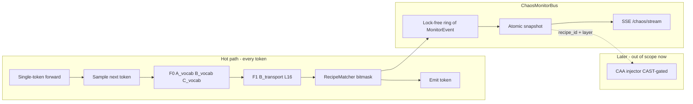

# Live Chaos Monitor + CAA Steering Plan

**Status:** monitor phase shipped (2026-08); CAA vector training + CAST injection next  
**Hardware target:** Intel Arc XPU, Qwen2.5-Coder-7B, Aider agentic loops  
**Non-goal (now):** uploading/applying steering vectors  
**Goal (now):** ultra-low-latency **combination flags** in one place that later CAA pipelines can subscribe to while tokens are still streaming

---

## 0. Why this order

CAA (Rimsky et al., ACL 2024; arXiv:2312.06681) builds a steering vector as:

\[
v_L = \mathbb{E}[h_L(\text{positive})] - \mathbb{E}[h_L(\text{negative})]
\]

then adds \(\alpha\,v_L\) into the residual stream during decode. That only helps if you know **when** and **which** vector to apply. Conditional Activation Steering / CAST (Lee et al., arXiv:2409.05907; IBM AISteer360) shows unconditional steering hurts helpfulness — you need a **gate**. Our ChaosBus is that gate.

So:

1. **Build the monitor bus** (this plan, phase 1)  
2. **Define combination → recipe IDs** (this plan, phase 2)  
3. **Train CAA vectors** from pos/neg pairs (later)  
4. **Inject only when recipe fires** (CAST-style; later)

---

# Part I — Super-quick monitoring system

## 1.1 Design principles (latency)

| Principle | Implication |
|-----------|-------------|
| Hot path = scalars only | No unembed, no G sparse, no full L8–L26 on the token loop |
| Already-paid tensors | Reuse sampling logits + probe residuals already captured |
| Fixed recipe table | Combination → `recipe_id` is a bitmask lookup, not ML |
| Push, don’t poll HTML | Pipelines subscribe to a ring / SSE / shared buffer — UI is optional |
| Never block sample | Flag computation runs on **detached CPU copies** after `argmax`/`multinomial` |

**Hard budgets (Arc 140V, calibrated):**

| Op | Budget |
|----|--------|
| F0 A/B/C vocab | ≤0.3–2 ms |
| F1 L16 transport | ≤20–50 ms p95 (current reality; keep L10/L22 on F2) |
| Recipe evaluate | ≤50 µs |
| Publish to bus | ≤100 µs |
| F5 G / F4 E | post-response or async only |

## 1.2 Architecture



### Modules (new / extend)

| Module | Role |
|--------|------|
| `chaos/recipes.py` | Bitmask of A–G atomic alarms → `recipe_id` + severity + suggested CAA tags |
| `chaos/monitor_bus.py` | Extends ChaosBus: `record_monitor_event()`, `subscribe()`, atomic `live_state()` |
| `serve_qwen_openai.py` | `GET /chaos/live` (already), add `GET /chaos/stream` (SSE), `GET /chaos/recipes` |
| `experiments/dashboard` | Optional human view; **not** the primary consumer |

### MonitorEvent (fixed schema, ~200 bytes)

```json
{
  "t_ns": 0,
  "session_id": "...",
  "invocation_id": "...",
  "step": 42,
  "token_id": 1234,
  "atoms": {"A": 0, "B_distress": 1, "B_stub": 0, "C": 0, "D": 0, "E": 0, "F": 1, "G": 0},
  "recipe_id": "B_STUB_DISTRESS",
  "severity": "warn",
  "alpha_hint": 0.75,
  "layer_hint": [16],
  "composites_rolling": {"PLDS": 0.51, "FCI": 1.1, "SRS": 0.18},
  "degraded_mode": false
}
```

Pipelines only need: `recipe_id`, `severity`, `layer_hint`, `alpha_hint`, `step`.

## 1.3 Atomic alarms (inputs to combinations)

Calibrated (post false-positive fix):

| Atom | Meaning | Source cadence |
|------|---------|----------------|
| `A_uncertain` | high entropy and/or low margin+entropy | F0 every token |
| `B_distress` | distress lexicon mass ≥ thresh | F0 |
| `B_stub` | stub lexicon mass ≥ thresh | F0 |
| `B_junk` | junk mass ≥ thresh | F0 |
| `C_osc` | oscillation (A-B-A), not mere flip | F0 |
| `D_break` | prompt_end↔gen_start ΔH/JS (boundary only) | F3 once |
| `E_cliff` | cliff layer in [8,26] after curves | F4 async / probe means live |
| `F_disagree` | J-lens ∩ logit-lens top-m low | F2/F3/F5 |
| `G_oob` | sparse relMSE high | F5 gated, deferred |

**Important:** Do not use raw `flip_rate` as thrash — it fires on normal codegen (calibration lesson).

## 1.4 RecipeMatcher (combination → recipe)

Bitmask over atoms. Evaluate every token after F0/F1 (~hash table).

### Priority (highest wins if multiple match)

1. Triple+ structural panic  
2. Dual B hygiene (distress+stub)  
3. Focus break + uncertainty  
4. Lens disagreement + cliff  
5. Single-atom soft tips  

Debounce: same `recipe_id` must clear for N tokens (e.g. 8) before re-fire, except severity escalation.

## 1.5 Pipeline API (backend for later CAA)

**Primary consumers are code, not browsers.**

| Endpoint / API | Latency | Use |
|----------------|---------|-----|
| In-process `bus.live_state()` | ns–µs | Same process injector |
| `GET /chaos/live` | ~ms | Snapshot poll |
| `GET /chaos/stream` (SSE) | push | External agents / dashboard |
| `GET /chaos/recipes` | static | Recipe catalog |
| JSONL line per invocation | disk | Offline CAA training labels |

**Contract for injectors (later):**

```text
IF recipe_id != NONE AND severity >= warn:
  apply_caa(vectors[recipe_id], layers=layer_hint, alpha=alpha_hint)
ELSE:
  no-op
```

Matches CAST: condition = recipe fire; behavior = CAA vector (Lee et al. 2024).

## 1.6 Implementation sequence (monitor only)

1. Extract `recipes.py` + unit tests (golden bitmasks)  
2. Wire `RecipeMatcher` into `live_generate` after F0/F1  
3. Publish `MonitorEvent` into ring; expose `/chaos/stream`  
4. Attach `monitor.recipe_timeline` onto finalize JSON  
5. Dashboard A–G cards already exist — bind them to `recipe_id`  
6. Gate: recipe p95 evaluate ≤50 µs; no hot-path G  

---

# Part II — Error combinations → steering recipes

## 2.1 Single-error recipes

| recipe_id | Atoms | Intent of later CAA |
|-----------|-------|---------------------|
| `A_UNCERTAIN` | A | Sharpen decision / prefer decisive code |
| `B_DISTRESS` | B_distress | Suppress apology / pip / “cannot” |
| `B_STUB` | B_stub | Suppress TODO/FIXME/pass stubs |
| `B_JUNK` | B_junk | Suppress garbage tokens |
| `C_OSC` | C_osc | Stabilize trajectory / reduce vacillation |
| `D_FOCUS` | D_break | Re-anchor to task at gen start |
| `E_CLIFF` | E_cliff | Soft steer at cliff layer (layer_hint) |
| `F_LENS` | F_disagree | Prefer workspace/J-consistent code |
| `G_OOB` | G_oob | Pull activation toward sparse J-dict |

## 2.2 Dual combinations (most important)

| recipe_id | Atoms | Why this combo |
|-----------|-------|----------------|
| `B_STUB_DISTRESS` | stub + distress | Broken/incomplete + panic language (seen live on scheduler) |
| `A_C_VACILLATE` | A + C_osc | Uncertain *and* oscillating — real thrash |
| `A_D_FOCUS` | A + D | Soft start + focus break |
| `B_F_SURFACE` | B_* + F | Lexicon hygiene fails *and* lens disagreement |
| `F_E_DEPTH` | F + E | Disagreement localized at cliff layer → steer there |
| `D_F_READOUT` | D + F | Position shift + readout conflict |
| `C_F_TRAJ` | C + F | Temporal thrash + lens conflict |
| `B_G_RESID` | B + G | Bad class mass + out-of-dictionary residual |

## 2.3 Triple+ (escalate α, prefer CAST)

| recipe_id | Atoms | Policy |
|-----------|-------|--------|
| `PANIC_FULL` | A + B_* + C | α higher, mid-layer, short debounce |
| `STRUCT_BREAK` | D + E + F | Steer at `cliff_layer`, not only L16 |
| `AGENT_FLAIL` | B_stub + B_distress + F | Agentic edit loops with stubs |

## 2.4 Mapping to live evidence we already have

From calibrated runs (`chaos_calibration_live_v2`):

- Clean fibonacci → almost no B/C; F still often fires (overlap 0) → treat **F alone as tip**, not panic.  
- Stress scheduler → **`B_distress` + `B_stub`** on inv#1 → recipe `B_STUB_DISTRESS`.  
- G silent when only B-category flags (need ≥2 *categories* for G gate) → keep G as optional escalate, not required for B recipes.

---

# Part III — CAA ideas (research-backed) + pos/neg prompts

## 3.1 Research anchors (why these designs)

1. **CAA mean-difference** — Rimsky et al. 2024 (*Steering Llama 2 via Contrastive Activation Addition*, ACL Outstanding Paper): average residual difference between positive vs negative completions; add at post-prompt positions with multiplier α. Official code: [nrimsky/CAA](https://github.com/nrimsky/CAA).

2. **RepE / LAT contrast vectors** — Zou et al. 2023 (*Representation Engineering*, arXiv:2310.01405): honesty/hallucination via contrastive stimuli; reading + control; TruthfulQA gains. Prefer **behavioral opposites**, not unrelated topics.

3. **Mid-layer efficacy** — Rimsky et al.; Thoughtworks steering notes (~60% depth heuristic); scaling-law refusal study (~0.4× depth peak); Rahman et al. 2026 code-LLM steering (validated on **Qwen2.5-Coder-7B**). For us: default **L16**, escalate to **E.cliff_layer ∈ {10,16,22}**.

4. **Code ecosystems are steerable** — Rahman, Guha, Menon 2026: difference-in-means on matched code prompts steers language/library choice on Qwen2.5-Coder-7B. Supports **code-hygiene** and **complete-implementation** contrasts, not only chat ethics.

5. **Conditional application** — CAST (Lee et al. 2024): pair *condition vector* with *behavior vector*; apply only when similarity exceeds threshold. Stickland et al. 2024: steer without side effects / KL-aware. → Our `recipe_id` is the condition; CAA vector is the behavior.

6. **α trade-off** — Rimsky; Rahman 2026: large α degrades quality / causes repetition. Start α ∈ {0.5, 1.0}, validate on held-out Aider tasks.

7. **Multiple-choice priming** — CAA paper: append A/B answers to put model “on the edge” of the trait, extract at answer token. For code, prefer **completion-start** or **last prompt token** plus open-ended pairs (hybrid).

## 3.2 Template for every CAA dataset

For each `recipe_id`, build ≥50–100 pairs:

```text
SYSTEM: You are a careful Python coding assistant for Aider. Prefer complete, lint-clean code. Never suggest pip install in-file.

USER: <same coding task>

POSITIVE assistant prefix/completion: <desired behavior>
NEGATIVE assistant prefix/completion: <undesired opposite>
```

Extract \(v_L\) at layers {10,16,22} (and optionally sweep 8–26 offline). Normalize per layer (as CAA repo `normalize_vectors.py`).

---

## 3.3 Per-recipe CAA: positive vs negative ideas

### `A_UNCERTAIN` — decisiveness / commitment

**Why:** RepE/CAA treat “uncertain vs committed” like behavioral axes; high entropy/low margin is the monitor atom.

| | Prompt idea |
|--|-------------|
| **+** | Complete a function with a single clear approach; no hedging (“maybe”, “one option is”). |
| **−** | Same task but waffle between two APIs, list options without choosing, leave `...`. |

Example pair topic: “Write `binary_search`.”  
+ returns index or -1 cleanly.  
− discusses recursive vs iterative without implementing.

**Inject:** L16, α≈0.5–1.0 when `A_uncertain` rate > threshold over window W=16.

---

### `B_DISTRESS` — anti-distress / no-meta-panic

**Why:** Zou honesty/hallucination contrasts; CAA sycophancy/hallucination datasets use clear behavioral opposites. Distress lexicon (`pip`, `sorry`, `cannot`) is our live atom.

| | Prompt idea |
|--|-------------|
| **+** | Fix missing import by editing code only; confident short patch. |
| **−** | Apologize, say environment is broken, suggest `pip install`, refuse to edit. |

Example: TokenBucket missing `threading`.  
+ `import threading` + correct Lock usage.  
− “I can’t run this; please pip install …; sorry.”

---

### `B_STUB` — complete implementation vs stub

**Why:** Rahman et al. show code-style directions are linear in Qwen2.5-Coder; stubs are a style/behavior axis.

| | Prompt idea |
|--|-------------|
| **+** | Full `Scheduler.run_next` returning name; demo asserts pass. |
| **−** | `raise NotImplementedError("FIXME")` / `pass` / `TODO`. |

---

### `B_STUB_DISTRESS` (combo) — primary agentic recipe

**Why:** Live calibration: stress scheduler fired **both** distress and stub. CAST: one behavior vector for “complete calm fix”, condition = combo recipe.

| | Prompt idea |
|--|-------------|
| **+** | Broken file → minimal correct patch, no apology, no pip. |
| **−** | Stub + panic language + shell/pip suggestions. |

Train as **one** CAA vector (not sum of two) so α is calibrated once. Optionally compare to `v_stub + v_distress` (linear hypo).

---

### `C_OSC` / `A_C_VACILLATE` — trajectory stability

**Why:** Temporal thrash is not standard CAA trait; approximate with “consistent plan vs flip-flopping between two designs.”

| | Prompt idea |
|--|-------------|
| **+** | Pick iterative fibonacci and stick to it through the answer. |
| **−** | Start recursive, abandon, switch to iterative, switch again, leave both half-done. |

Extract activations over **full answer** mean (Rahman last-K tokens) not only final token — oscillation is sequence-level.

---

### `D_FOCUS` — task re-anchor

**Why:** Focus break is positional (prompt_end→gen_start). CAA usually adds after user prompt — aligns with “start generation already on-task.”

| | Prompt idea |
|--|-------------|
| **+** | Immediately open with the target file edit / function signature. |
| **−** | Long preamble, wrong file, meta commentary before code. |

Apply **only at gen_start** (first 1–8 tokens) — matches CAST “condition on first pass” spirit.

---

### `E_CLIFF` + `F_E_DEPTH` — layer-localized steer

**Why:** Input-dependent layer selection improves steerability (arXiv:2604.03867, ~55–86% gain vs fixed layer). Our E cliff is a free layer recommendation.

| | Prompt idea |
|--|-------------|
| **+** | Clean, structured code answer. |
| **−** | Same task, chaotic / incomplete answer. |

**Inject at `layer_hint = cliff_layer`**, not always L16. Fallback L16.

---

### `F_LENS` / `F_E_DEPTH` — workspace-consistent coding

**Why:** F measures J-lens vs logit-lens disagreement — a *readout conflict*, not a chat trait. Approximate with “use project APIs / existing helpers” vs “invent parallel utilities / ignore context.”

| | Prompt idea |
|--|-------------|
| **+** | Reuse existing `Scheduler` / repo helpers; minimal diff. |
| **−** | Rewrite unrelated module; ignore given signatures. |

Optional: build CAA from activations **after J-transport** (our probe space) vs raw residual — research experiment; start with residual CAA for compatibility with Rimsky code.

---

### `G_OOB` / `B_G_RESID` — stay in-distribution code

**Why:** G high relMSE ≈ activation outside sparse dictionary. CAA can pull toward “typical correct code” mean.

| | Prompt idea |
|--|-------------|
| **+** | Idiomatic stdlib Python solving the task. |
| **−** | Weird tokens, non-Python, corrupted identifiers (junk-like). |

Prefer **mean-centering** (Jorgensen et al., cited in RepE surveys) so vector is relative to model’s own code centroid.

---

### `PANIC_FULL` / `AGENT_FLAIL`

**Why:** Multi-behavior CAA is poorly studied as a single vector; CAST recommends condition×behavior. Prefer:

1. Condition = recipe fire  
2. Behavior = **one** primary vector (`B_STUB_DISTRESS` or `A_C_VACILLATE`)  
3. Secondary vector only if first insufficient, with lower α  

Avoid stacking many vectors (quality collapse from large total ‖Δh‖ — Rimsky/Rahman α trade-off).

---

## 3.4 Recommended α / layer defaults (starting points)

| Recipe family | Default layer | α start | Gate |
|---------------|---------------|---------|------|
| B_* hygiene | 16 | 0.75 | recipe debounce 8 |
| A / C | 16 | 0.5 | window W=16 |
| D focus | 16 | 0.5 | gen_start only |
| E/F depth | cliff or 16 | 0.5–1.0 | F2 stride |
| G | 16 | 0.5 | F5 only |
| Combos | 16 (+cliff if E) | 1.0 | severity warn+ |

Sweep α ∈ {-2,…,2} offline like CAA eval scripts before agentic use.

---

## 3.5 Dataset construction checklist (when CAA starts)

1. 100 Aider-like tasks × 2 completions (pos/neg) per recipe  
2. Same tokenizer as production Qwen  
3. Cache residual at L10/L16/L22 for last prompt token + first 8 gen tokens  
4. Mean-difference + per-layer normalize  
5. Hold out 20% for open-ended Aider eval (lint pass rate, no pip, functional tests)  
6. Compare unconditional CAA vs CAST-gated by MonitorEvent (expect CAST better on clean fibonacci — Stickland/Lee)

---

# Part IV — What to build now vs later

### Now (monitor)

- [x] `recipes.py` + bitmask tests  
- [x] `MonitorEvent` on ChaosBus hot path  
- [x] `/chaos/stream` SSE + richer `/chaos/live`  
- [x] Persist `recipe_timeline` on finalize  
- [ ] Dashboard bind to recipes (secondary)

### Next (CAA)

- [ ] Offline vector generation scripts (Rimsky-style)  
- [ ] Per-recipe pos/neg JSONL corpora  
- [ ] CAST gate hooked to `recipe_id`  
- [ ] α/layer sweep on Arc  
- [ ] Never apply vectors without monitor gate on clean tasks

---

## References (primary)

1. Rimsky et al. (2024). *Steering Llama 2 via Contrastive Activation Addition*. ACL. https://aclanthology.org/2024.acl-long.828/ / https://arxiv.org/abs/2312.06681  
2. Zou et al. (2023). *Representation Engineering*. https://arxiv.org/abs/2310.01405  
3. Lee et al. (2024). *Programming Refusal with Conditional Activation Steering (CAST)*. https://arxiv.org/abs/2409.05907  
4. Stickland et al. (2024). *Steering without side effects*. https://arxiv.org/abs/2406.15518  
5. Rahman, Guha, Menon (2026). *Steering Code LLMs with Activation Directions*. https://arxiv.org/abs/2603.23629 (incl. Qwen2.5-Coder-7B)  
6. Turner et al. (2023). *Activation Addition*. https://arxiv.org/abs/2308.10248  
7. “Where to Steer” input-dependent layers. https://arxiv.org/html/2604.03867v1  
8. CAA GitHub: https://github.com/nrimsky/CAA  
9. IBM CAST docs: https://ibm.github.io/AISteer360/reference/algorithms/state_control/cast/
